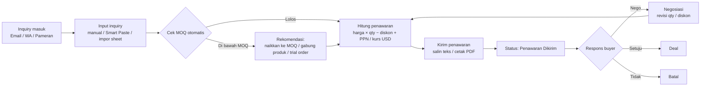
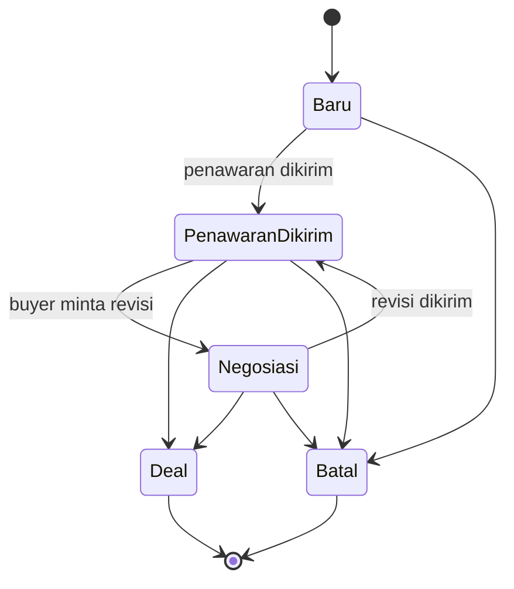
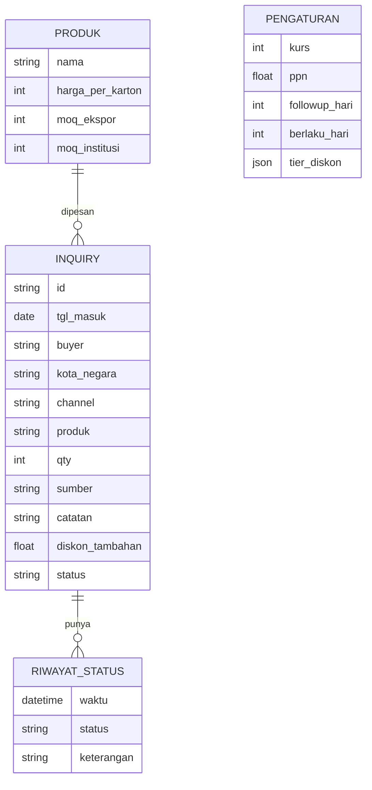

# Kebutuhan Fitur — Web App Inquiry Tracker (Ekspor & Institusi)

## 1. Latar belakang & masalah

Inquiry dari buyer **ekspor** dan **institusi** (hotel, rumah sakit, katering, kantin) masuk lewat **email, WhatsApp, dan pameran**. Saat ini:

| Masalah | Dampak |
|---|---|
| Inquiry tercecer di 3 kanal | Ada inquiry yang lupa dibalas, buyer pindah ke kompetitor |
| Penawaran dihitung manual | Lambat, rawan salah hitung diskon/PPN/kurs, harga tidak konsisten |
| MOQ dicek manual | Penawaran terkirim untuk qty di bawah MOQ, atau peluang upsell terlewat |
| Status sulit dipantau | Manajer tidak tahu mana yang sudah ditawar, sedang nego, deal, atau batal |

**Tujuan:** satu tempat untuk mencatat semua inquiry, menghitung penawaran & cek MOQ secara otomatis, memantau status, dan melihat ringkasan di dashboard.

## 2. Temuan dari data awal (18 inquiry, November 2026)

| Temuan | Angka | Implikasi fitur |
|---|---|---|
| Channel | 10 ekspor, 8 institusi | Penawaran perlu dua format: USD/FOB (ekspor) & Rupiah + PPN (institusi) |
| Sumber | WhatsApp 7, Email 6, Pameran 5 | Perlu input cepat dari teks chat/email → **Smart Paste** |
| Volume | Ekspor 100–1.000 krt, institusi 10–50 krt | MOQ harus **dibedakan per channel** |
| Repeat buyer | Al Noor (4×), Desert Rose (3×), Hotel Grand Pelita (3×), dll. | Kelompokkan per buyer, tandai "repeat", usulkan penawaran gabungan/kontrak |
| Deadline | 3 inquiry "butuh kirim sebelum akhir bulan" | Skor **prioritas** + daftar "Butuh tindakan" |
| Permintaan khusus | diskon order rutin (3), katalog (3), harga + sample (3), umur simpan (1), MOQ lebih kecil (1) | **Rekomendasi tindakan** otomatis dari catatan |

## 3. Pengguna & peran

| Peran | Kebutuhan utama |
|---|---|
| Staf sales (ekspor / institusi) | Input inquiry cepat, hitung penawaran, kirim teks penawaran, update status |
| Manajer sales | Dashboard, prioritas, inquiry yang telat di-follow-up, nilai pipeline |
| Admin | Kelola daftar harga, MOQ, kurs, PPN, tier diskon |

## 4. Alur proses



### Siklus status



Setiap perubahan status dicatat di **riwayat** (waktu + keterangan). Inquiry berstatus *Baru* atau *Penawaran Dikirim* yang tidak di-update lebih dari **N hari** (default 3) ditandai **perlu follow-up**.

## 5. Kebutuhan fungsional

### A. Input inquiry
| ID | Kebutuhan | Prioritas |
|---|---|---|
| F-01 | Form input: tanggal, buyer, kota/negara, channel, produk, qty (karton), sumber, catatan, diskon tambahan | Wajib |
| F-02 | Autocomplete nama buyer; buyer lama otomatis mengisi kota & channel | Wajib |
| F-03 | **Smart Paste**: tempel teks email/WA → sistem mengisi buyer, produk, qty, negara/kota, channel, sumber, dan catatan (deadline, sample, katalog, diskon, MOQ) | Wajib (fitur AI) |
| F-04 | Impor massal: tempel baris dari Excel/Google Sheets (format sheet saat ini) | Wajib |
| F-05 | Pratinjau penawaran & cek MOQ **langsung saat mengetik**, sebelum disimpan | Wajib |
| F-06 | ID otomatis (INQ-001, …) dan nomor penawaran (Q-YYMM-nnn) | Wajib |

### B. Hitung penawaran
| ID | Kebutuhan |
|---|---|
| F-07 | Subtotal = qty × harga per karton |
| F-08 | Diskon = tier volume (mis. ≥500 krt 3%, ≥1.000 krt 5%) + diskon tambahan manual (maks. 50%) |
| F-09 | Institusi: + PPN (default 11%), mata uang Rupiah |
| F-10 | Ekspor: PPN 0%, harga FOB, dikonversi ke **USD** dengan kurs yang bisa diatur |
| F-11 | Info "tambah X karton lagi untuk diskon Y%" (dorong upsell) |
| F-12 | Teks penawaran siap kirim: **English** untuk ekspor, **Indonesia** untuk institusi; tombol salin |
| F-13 | Cetak / simpan PDF surat penawaran |

**Rumus:**
```
subtotal  = qty × harga
diskon %  = tier_volume(qty) + diskon_tambahan
dpp       = subtotal − subtotal × diskon%
pajak     = channel == Institusi ? dpp × PPN% : 0
total     = dpp + pajak
total_usd = channel == Ekspor ? total / kurs : –
```

### C. Cek MOQ
| ID | Kebutuhan |
|---|---|
| F-14 | MOQ per produk **per channel** (MOQ ekspor & MOQ institusi) |
| F-15 | Badge ✓ Lolos / ✕ Kurang N karton di daftar, detail, dan pratinjau |
| F-16 | Jika di bawah MOQ: tampilkan nilai penawaran bila dinaikkan ke MOQ + saran gabung produk / trial order |

### D. Status & follow-up
| ID | Kebutuhan |
|---|---|
| F-17 | Status: Baru → Penawaran Dikirim → Negosiasi → Deal / Batal (bisa diubah dari daftar atau detail) |
| F-18 | Riwayat perubahan (timeline) dengan keterangan |
| F-19 | Penanda telat follow-up (jumlah hari sejak update terakhir) |
| F-20 | Pencarian & filter (channel, status, lolos/tidak MOQ), urut prioritas / tanggal / nilai |
| F-21 | Ekspor CSV untuk laporan |

### E. Asisten AI (rule-based sekarang, LLM di tahap berikutnya)
| ID | Kebutuhan |
|---|---|
| F-22 | **Skor prioritas 0–100**: nilai penawaran (40) + deadline/urgent (30) + repeat buyer (15) + lolos MOQ (15) → Tinggi / Sedang / Rendah |
| F-23 | **Rekomendasi tindakan** dari catatan & data: kirim sample/katalog, info shelf life, skema kontrak untuk order rutin, cek stok untuk deadline, follow-up yang telat |
| F-24 | Smart Paste (F-03) |
| F-25 *(roadmap)* | Ganti parser aturan dengan LLM: ekstraksi dari teks bebas multi-bahasa (Arab/Inggris), ringkasan percakapan, draf balasan email yang menyesuaikan konteks negosiasi |
| F-26 *(roadmap)* | Prediksi peluang deal berdasarkan histori (setelah data Deal/Batal cukup) |

### F. Master data
| ID | Kebutuhan |
|---|---|
| F-27 | Kelola produk: nama, harga/karton, MOQ ekspor, MOQ institusi |
| F-28 | Aturan: kurs USD, PPN, tier diskon, batas hari follow-up, masa berlaku penawaran |
| F-29 | Perubahan harga/MOQ langsung menghitung ulang semua penawaran |

## 6. Dashboard (rekomendasi diagram)

| Komponen | Jenis visual | Pertanyaan yang dijawab |
|---|---|---|
| KPI: total inquiry, nilai penawaran (Rp & USD), % lolos MOQ, deal rate, perlu follow-up | Kartu angka | "Bagaimana kondisi pipeline hari ini?" |
| Butuh tindakan (top 6) | Daftar berprioritas + rekomendasi | "Apa yang harus dikerjakan duluan?" |
| Inquiry per channel | Donut (2 bagian) | Porsi ekspor vs institusi |
| Sumber inquiry | Bar | Kanal mana paling produktif (WA/Email/Pameran) |
| Nilai penawaran per produk | Bar horizontal bertumpuk (ekspor/institusi) | Produk mana paling bernilai |
| Cek MOQ per produk | Bar bertumpuk lolos/di bawah | Produk mana MOQ-nya sering jadi hambatan |
| Pipeline status | Bar horizontal | Berapa yang macet di tiap tahap |
| Nilai ekspor per negara | Bar (USD) | Pasar ekspor terbesar |
| Tren inquiry per hari | Bar bertumpuk per channel | Lonjakan setelah pameran, pola mingguan |
| Top buyer | Tabel + badge repeat | Kandidat kontrak rutin |

Ketentuan: filter (channel, produk, status) di satu baris di atas grafik; setiap grafik punya **tooltip** dan tombol **Tabel** (aksesibilitas); mendukung mode terang & gelap; warna status selalu disertai ikon + label.

## 7. Model data



## 8. Kebutuhan non-fungsional
- Berjalan di browser (desktop & HP), tanpa instalasi; responsif hingga lebar ±360px.
- Hitung penawaran < 100 ms; dashboard ter-update langsung saat data berubah.
- Data tersimpan otomatis (versi ini: `localStorage` browser → **per perangkat**).
- Tahap produksi: database server (mis. PostgreSQL/Supabase) + login per peran + data bersama antar staf.
- Penawaran yang sudah dikirim sebaiknya dikunci (versi) agar perubahan harga tidak mengubah histori.

## 9. Implementasi (versi saat ini)

| File | Isi |
|---|---|
| `index.html` | Struktur 4 menu: Dashboard, Daftar Inquiry, Input Inquiry, Master Produk |
| `style.css` | Tampilan, mode terang/gelap, responsif, layout cetak |
| `app.js` | Data awal 18 inquiry, logika penawaran, MOQ, prioritas, rekomendasi, Smart Paste, grafik (Chart.js) |

**Cara menjalankan:** buka `index.html` di browser (Chrome/Edge). Grafik butuh internet untuk memuat Chart.js; tanpa internet, data tetap bisa dilihat lewat tombol **Tabel**.

> ⚠️ **Harga & MOQ di Master Produk masih nilai contoh** (daftar harga resmi belum dilampirkan). Ganti di menu **Master Produk** → **Simpan**, semua penawaran & cek MOQ otomatis dihitung ulang. Nilai default juga bisa diubah di `PRODUK_DEFAULT` pada `app.js`.

## 10. Roadmap
1. **Tahap 1 (selesai di prototipe ini):** input, Smart Paste, hitung penawaran, cek MOQ, status & riwayat, prioritas, dashboard, CSV.
2. **Tahap 2:** backend + login, data bersama tim, lampiran (katalog/PDF), pengingat follow-up via email/WA.
3. **Tahap 3:** integrasi LLM (ekstraksi multi-bahasa, draf balasan), integrasi WhatsApp Business API & inbox email, prediksi peluang deal.
